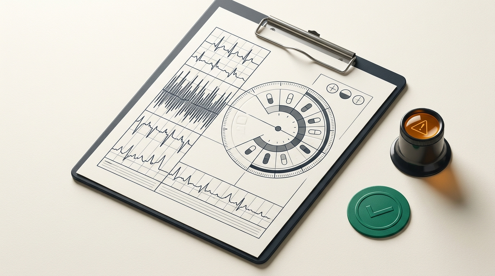

# ClinNote: Client-Side Clinical Discharge De-Jargonizer & Medication Safety Workbench

**Live Workbench:** [https://aariv.me/clinnote/](https://aariv.me/clinnote/)

ClinNote is a 100% client-side clinical NLP discharge translator, bilingual (`EN / ES`) readability telemetry analyzer, 24-hour medication collision simulator, and red-flag symptom triage workbench built for the **STEM2Connect AI Hackathon 2026**.



## The Clinical Problem

Hospital and Emergency Department discharge summaries average a **Flesch-Kincaid Grade 11 to 14** reading level. Patients and caregivers returning home are handed dense paragraphs containing Latin dosing shorthand (`PO`, `BID`, `q12h`, `PRN`, `AC`), unexplained laboratory telemetry (`eGFR 52 mL/min/1.73m2`, `HbA1c 7.8%`, `SpO2 >= 94%`), and unflagged over-the-counter (OTC) medication hazards that lead to preventable hospital readmissions.

## Key Capabilities

### 1. Deterministic Clinical NLP De-Jargonizer & Readability Telemetry
- Translates **38+ clinical abbreviations and medical terms** (`PO`, `BID`, `TID`, `QID`, `QD`, `QAM`, `QHS`, `q4h`, `q6h`, `q8h`, `q12h`, `PRN`, `NPO`, `AC`, `PC`, `MDI`, `titrate`, `contraindicated`, `dyspnea`, `intercostal retractions`, `orthostatic hypotension`, `nephrotoxicity`, `eGFR`, `HbA1c`, `SpO2`, `melena`, `hemoptysis`, `epistaxis`, `chelation`, `postprandial`, `hypoglycemia`, `hyperkalemia`, `bronchospasm`, `arthroplasty`, `anticoagulation`, `malabsorption`, `subcutaneous`, `syncope`) into plain **Grade 5 to 6** patient instructions.
- Full bilingual support in **English (`en`)** and **Espanol (`es`)**.
- Real-time calculation of **Flesch-Kincaid Grade Level**, **Syllable-per-Word Density**, **Jargon Term Count**, and **Comprehension Clarity Gain (`%`)** on both preset clinical cases and custom pasted discharge text.

### 2. Four Realistic Clinical Discharge & Lab Telemetry Scenarios
1. **`pediatric-asthma-er` (`ER-PULM-01`):** Post-ER Acute Bronchospasm & Oral Corticosteroid Taper (`Albuterol 90 mcg MDI 2 puffs q4h PRN wheezing`, `Prednisone 20 mg PO QD with breakfast x5d`, `SpO2 >= 94%`, `intercostal retractions`).
2. **`t2d-renal-titration` (`NEPH-ENDO-02`):** Type 2 Diabetes & CKD Stage 3a Lab Telemetry (`Metformin ER 500 mg PO BID with meals`, `Lisinopril 10 mg PO QD`, `Empagliflozin 10 mg PO QAM`, `HbA1c 7.8%`, `eGFR 52 mL/min/1.73m2`, `K+ 4.9 mEq/L`).
3. **`postop-anticoag-ortho` (`ORTHO-COAG-03`):** Post-Op Knee Arthroplasty & Anticoagulation (`Apixaban 2.5 mg PO BID q12h`, `Acetaminophen 650 mg PO q6h PRN pain`, `Oxycodone 5 mg PO q6h PRN severe pain`).
4. **`hypertensive-thyroid-sync` (`CARD-ENDO-04`):** Hypertensive Urgency Follow-Up & Morning Absorption Separation (`Levothyroxine 75 mcg PO QAM on empty stomach 60m AC`, `Amlodipine 5 mg PO QD`, `Calcium Carbonate 600 mg PO BID with meals`).

### 3. 24-Hour Medication Schedule & OTC Pharmacokinetic Collision Matrix
- Generates an interactive 24-hour SVG dosing clock across 7 daily clinical checkpoints (`06:00`, `08:00`, `12:00`, `14:00`, `18:00`, `20:00`, `22:00`).
- Simulates adding common household OTC items (`Ibuprofen 400 mg NSAID`, `Calcium 600 mg + Iron Supplement`, `Diphenhydramine 25 mg Sedative`, `Grapefruit Juice`) and deterministically flags:
  - `CRITICALCONTRAINDICATION`: Major hemorrhage risk (`Apixaban` + `Ibuprofen`) or `CYP3A4` enzymatic inhibition (`Grapefruit Juice` + `Apixaban` / `Amlodipine`).
  - `RENAL_TRIPLE_WHAMMY`: Acute kidney injury risk when adding an NSAID (`Ibuprofen`) to an ACE inhibitor (`Lisinopril`) and SGLT2 inhibitor (`Empagliflozin`) in Stage 3a CKD (`eGFR 52`).
  - `ABSORPTION_CHELATION`: Divalent cation binding when taking `Calcium / Iron` within 4 hours of fasting `Levothyroxine`.
  - `SEDATION_STACK`: Additive central nervous system and respiratory depression when combining `Oxycodone` with `Diphenhydramine` at `22:00`.

### 4. Red-Flag Symptom Triage & Printable Bilingual Refrigerator Schedule
- Interactive post-discharge symptom checker computing deterministic dispositions (`ROUTINE HOME CARE`, `SAME-DAY CLINIC CALL`, `IMMEDIATE EMERGENCY DEPARTMENT`).
- Dedicated `@media print` stylesheet producing a clean 1-page **Bilingual Refrigerator Medication & Red-Flag Schedule**.

## Local Verification & Automated Test Suite

ClinNote has zero external runtime dependencies and includes a 51-test Node.js test suite (`tests/clinnote.test.js`):

```bash
npm test
```

## AI & Privacy Attribution Section

- **100% Client-Side Privacy Architecture (Zero PHI Cloud Transmission):** ClinNote runs its entire clinical NLP de-jargonizer, Flesch-Kincaid readability calculator, and pharmacokinetic collision matrix locally inside the user's browser. A strict `Content-Security-Policy` (`connect-src 'none'`) enforces that zero patient health information (PHI) or custom discharge text ever leaves the device.
- **AI Assistance Disclosure (STEM2Connect AI Hackathon 2026):** Built for the STEM2Connect AI Hackathon 2026. AI coding and illustration tools (Claude / Gemini) assisted with modular UI scaffolding, bilingual lexicon compilation, and the editorial hero diagram (`img/clinnote-hero.jpg`). All pharmacokinetic collision rules, readability formulas, and 51 automated unit tests were deterministically authored and verified.
- **Clinical Disclaimer:** ClinNote is an educational clinical communication and medication literacy tool and is not a substitute for professional medical advice, diagnosis, or pharmacist consultation.
